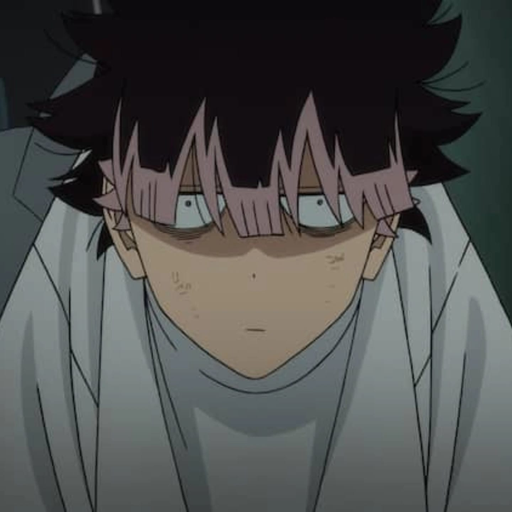

{ .narumi-hero-image }

# Beyond Engineering

**A personal atlas of journeys, places and experiences.**

From rail crossings and remote landscapes to running events, food, live music and global exhibitions — a collection of experiences beyond my technical work.

[Explore travels](travels/index.md) · [Browse the travel directory](map.md) · [Engineering portfolio](https://alvvvli.github.io/alvin-site/)

## Explore

### 🌍 Travels
Documented journeys across continents, cities and borders.

[Browse continents](travels/index.md)

### 🏃 Sports & Activities
Running, skiing, hiking and live sport.

[Explore activities](sports/index.md)

### 🍜 Food & Dining
Local food and memorable meals, added as they are verified.

[Explore food](food/index.md)

### 🎵 Events & Experiences
Concerts, Formula 1, football and exhibitions.

[Explore events](events/index.md)

## Selected experiences

| Experience | Location | Explore |
|---|---|---|
| Seattle Sakura Run 10K | United States · 2024 | [Sports](sports/activities.md) |
| ANA Lake Toya 5K | Japan · 2024 | [Sports](sports/activities.md) |
| InnoTrans | Germany · 2024 / 2026 | [Events](events/exhibitions.md) |
| Icelandic landscapes | Iceland · 2023 | [Europe](travels/europe.md) |
| KÀ — Cirque du Soleil | Las Vegas · 2025 | [Live shows](events/concerts.md) |

FEATURED TRAVEL COLLAGE — ADD IMAGES LATER

!!! note "About the archive"
    Journeys are drawn from a redacted personal travel record and other previously documented travels. Private booking, payment and accommodation information is deliberately excluded. Planning notes are not automatically presented as completed experiences.

<small>Site artwork: [Kaiju No. 8 — official website](https://kaiju-no8.net/). Character artwork belongs to its respective rights holders.</small>
